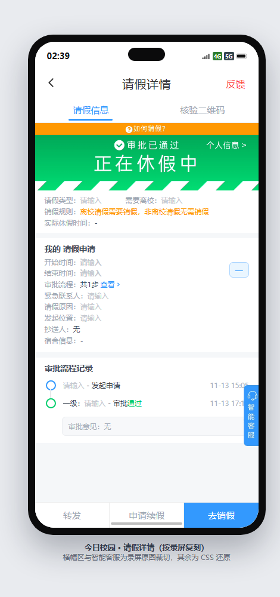
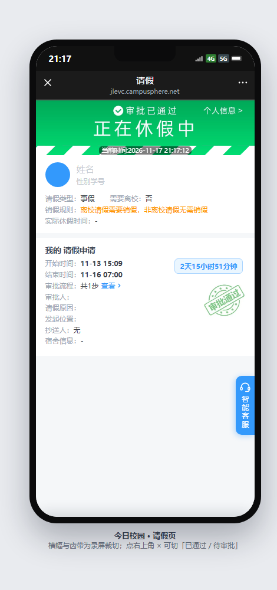

# 校园请假 UI 复刻（Web + Android 壳）

按录屏/截图 1:1 复刻的「请假详情」与「请假页」两个界面，纯静态、零依赖、可打包成 APK。
**仅用于交流学习**，与任何学校、公司的真实系统无关，不含任何真实数据。

<p align="center">
  
  
</p>

## 下载安装包

不想自己编译的话，直接下预编译的 APK：

**[⬇ campus-leave-ui-v1.0.0.apk](https://github.com/aaaafule/campus-leave-ui/releases/download/v1.0.0/campus-leave-ui-v1.0.0.apk)**　·　260.8 KB　·　Android 5.0+

传到手机点开即可安装（首次会提示"未知来源"，允许即可）。包名 `com.sim.leave`，**零权限**。
校验：SHA-256 `ad0e23e8e356f1cfc4addb5133d6f0c20712dbc6c1149fd3e575c8cbb450957c`

## 这个仓库里有什么

```
detail/    请假详情页（第一页）：导航、标签页、绿色横幅、审批流程记录、底部操作栏
leave/     请假页（第二页）：审批横幅、个人信息、申请明细、审批流程弹层
share/     把一张假条编码成链接的分享页构建脚本
android/   把页面装进 WebView 的原生壳（自己签名打包 APK）
tools/     单文件构建脚本（把页面 + 图片内联成一个 HTML）
```

两个页面都提供两份入口：

| 文件 | 用途 |
|---|---|
| `index.html` | 桌面预览（带手机外框、状态栏、浏览器栏） |
| `mobile.html` | 手机上真机运行（去掉外壳，按 375 设计宽等比铺满屏宽） |

## 快速开始

```bash
git clone <this-repo>
cd <repo>

# 直接看
start detail/mobile.html          # Windows
open  detail/mobile.html          # macOS

# 或者起个静态服务器（分享链接功能需要 http 环境）
python -m http.server 8000
# 浏览器打开 http://127.0.0.1:8000/detail/mobile.html
```

## 功能

**第一页 · 请假详情**

- 9 个字段可编辑（类型 / 需否离校 / 起止时间 / 紧急联系人 / 原因 / 发起位置 / 发起人 / 审批人），编辑态与展示态共用同一套 CSS，字体完全不变
- 开始/结束时间点击弹出选择器：月历 + 时/分滚轮，输出 `MM-DD HH:mm`
- 审批流程记录右侧的两个时间也用同一个选择器
- 时长徽章自动按起止计算；空值 / 格式非法 / 结束≤开始 一律显示 `—`
- 左下角「转发」→ 跳到第二页，并把 7 项内容 + 两个名字带过去

**第二页 · 请假页**

- 姓名 / 性别学号可编辑，蓝色圆圈里的字自动取姓名后两位
- 「查看」弹层展示审批流程
- 右下角有一个**隐形热区**，点它生成分享链接（离线时改为复制假条文字）

**通用**

- 启动动画：「本程序仅供交流学习使用」淡入淡出
- 每一次打开都是空白模板，不残留上次填写的内容
- 手机上整页按 `innerWidth / 375` 等比缩放，不会被拉伸

## 分享假条

`share/build-share.mjs` 会生成一个自包含的 `share/index.html`：
假条内容编码在链接的 `#d=<base64url(JSON)>` 里，对方打开链接即可查看，不需要后端。

```bash
node tools/build-standalone.mjs leave     # 先出单文件版
node share/build-share.mjs                # 再生成分享页
```

**注意**：链接要能被别人打开，这个 HTML 必须放在公网静态托管上
（GitHub Pages / Netlify / 任意 OSS）。详见 [`share/README.md`](share/README.md)。

## 打包成 APK

`android/` 里是一个最小 WebView 壳：
用 `loadDataWithBaseURL('https://appassets.local/', …)` 加载 assets 里的页面，
再用 `shouldInterceptRequest` 把页面之间的跳转从 assets 里取出来——不联网、零权限。

```powershell
# 需要 JDK 17 + Android SDK build-tools 34
pwsh android/build-apk.ps1 `
  -Jdk   "C:\path\to\jdk-17" `
  -BuildTools "C:\path\to\android-sdk\build-tools\34.0.0" `
  -KeyStore "C:\path\to\your.jks"
```

## 技术要点

- **测量驱动**：所有尺寸来自对截图/录屏的像素统计（墨迹包围盒、行剖面、颜色中位数），
  不是凭感觉调的。例如时钟胶囊 157.3 × 13.9 CSS、压暗 alpha 0.50 都是从 1216 宽截图
  按 3.243 的缩放比反算出来的。
- **贴图与 CSS 混合**：横幅、齿带、印章、客服侧标这些用录屏裁切贴图保证字形一致，
  其余全部用 CSS 还原，改文案/换数据时不会破坏图形。
- **只覆盖有值的字段**：跨页继承时，上一页留空的项保留本页原值，避免继承出一片空白。
- **每次打开重置**：不使用 localStorage，刷新即回空白模板；跨页传递用 sessionStorage 且读完即删。

## 目录细节

更完整的还原过程（每一处尺寸怎么量的、为什么这么改）在 `docs/NOTES.md`。

## 许可证

[MIT](LICENSE)。素材（横幅、齿带、印章等）由本项目自行裁切生成，仅供学习演示。
